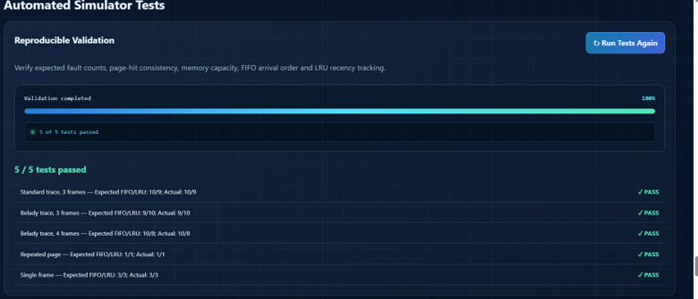

# Group04_CSCE5610_FA26

**CSCE 5610 – Computer Architecture | Fall 2026**

## Group 4 – Team Project

### Team Members

1. **Ruchitha Sri Sai Valli Thanmayee Potladurthy**
   - Student ID: 11855553
2. **Adla Sanjay Ramaswamy**
   - Student ID: 11828288
3. **Dharani Kondapally**
   - Student ID: 11853256

## Project Title

**Comparative Analysis of FIFO and LRU Page Replacement Algorithms in Virtual Memory**

## Project Overview

This project focuses on virtual memory management in computer architecture. The goal is to implement, simulate, and compare two commonly used page replacement algorithms: First-In, First-Out (FIFO) and Least Recently Used (LRU).

The simulator demonstrates how page replacement algorithms manage memory when the available number of frames is limited. By processing identical page-reference strings under the same memory constraints, the project evaluates differences in page faults, page hits, and overall replacement behavior.

The project includes an interactive web-based simulator, algorithm comparison visualizations, automated testing, and documented experimental results.

## Project Objectives

- Implement FIFO and LRU page replacement algorithms.
- Simulate page-reference requests using configurable memory-frame sizes.
- Track page hits, page faults, and memory-frame changes.
- Compare the algorithms using identical workloads.
- Calculate page-fault rates and page-hit ratios.
- Visualize differences in page replacement performance.
- Examine Belady's anomaly in FIFO.
- Validate the implementation using automated test cases.
- Analyze the results and identify scenarios where each algorithm performs differently.

## Architecture Component

The primary architecture component studied is **virtual memory and page replacement**.

When a requested page is not currently available in memory, a page fault occurs. If all memory frames are occupied, the operating system must select a page for replacement.

The project investigates two replacement policies:

**FIFO (First-In, First-Out):** Replaces the page that has been in memory the longest, based on its arrival order.

**LRU (Least Recently Used):** Replaces the page that has not been accessed for the longest time.

These algorithms are compared to understand how different replacement strategies affect memory performance.

## Implemented Features

The current simulator includes:

- FIFO page replacement simulation.
- LRU page replacement simulation.
- Interactive page-reference input.
- Configurable memory-frame counts.
- Step-by-step simulation and memory-frame visualization.
- Tracking of page hits and page faults.
- Calculation of performance metrics.
- Side-by-side FIFO and LRU comparisons.
- Interactive performance charts.
- Demonstration of Belady's anomaly.
- Automated simulator validation.
- Documented test results and test evidence.

## Workloads and Performance Metrics

Both algorithms are evaluated using the same page-reference strings and memory-frame configurations.

### Workloads

The project uses standard reference strings, repeated page accesses, single-frame scenarios, and workloads designed to illustrate Belady's anomaly.

Frame configurations include 3, 4, and 5 frames, along with additional configurations for testing.

### Performance Metrics

- Total number of page faults
- Total number of page hits
- Page-fault rate
- Page-hit ratio
- Memory-frame replacement behavior
- Differences between FIFO and LRU across workloads

## Current Project Status – October 2026

The team has completed the initial research, project planning, simulator design, core algorithm implementation, integration, and initial automated validation.

### Completed Work

**1. Project Planning and Research**

- Selected virtual memory page replacement as the architecture topic.
- Researched FIFO and LRU algorithms.
- Identified representative page-reference workloads.
- Selected relevant comparison metrics.
- Prepared the project proposal and initial simulation design.

**2. Algorithm Implementation**

- Implemented FIFO page replacement logic.
- Implemented LRU page replacement logic.
- Integrated both algorithms into a shared simulation framework.
- Added page-hit and page-fault calculations.

**3. Interactive Simulator Development**

- Developed a browser-based user interface using HTML, CSS, and JavaScript.
- Added user-configurable simulation inputs.
- Implemented memory-frame visualizations.
- Added algorithm comparison charts and performance summaries.
- Integrated automated test execution into the website.

**4. Automated Testing**

The simulator has been tested using Node.js and browser-based validation.

The documented Node.js test runner successfully completed all five test cases.

| Test Case | FIFO Faults | LRU Faults | Status |
|---|---:|---:|---|
| Standard Reference String | 10 | 9 | PASS |
| Belady's Anomaly – 3 Frames | 9 | 10 | PASS |
| Belady's Anomaly – 4 Frames | 10 | 8 | PASS |
| Repeated Page Accesses | 1 | 1 | PASS |
| Single Memory Frame | 3 | 3 | PASS |

**Automated Test Summary: 5/5 Passed**

The existing engine test suite also reported **16 assertions/cases plus invariant checks across 12 configurations**, covering reference behavior, Belady's anomaly, parsing, and edge cases.

The interactive website separately reported **5/5 automated tests passed**.

**5. GitHub Development and Collaboration**

- Uploaded the simulator source code to GitHub.
- Organized implementation and testing files.
- Maintained a GitHub Project Board with To Do, In Progress, and Done tasks.
- Uploaded automated test results in JSON format.
- Added screenshot evidence of website test execution.

## Technologies and Development Tools

- **HTML5:** Web interface structure
- **CSS3:** Website styling and layouts
- **JavaScript:** FIFO/LRU algorithms, simulation logic, and interactive functionality
- **Node.js:** Automated JavaScript testing
- **Visual Studio Code:** Development environment
- **Git and GitHub:** Version control and collaboration
- **GitHub Projects:** Task management and progress tracking

The current web simulator runs in a browser without requiring an external architecture simulator or specialized hardware.

## Repository Structure

The implementation is located inside the `CSCE5610_Group_4/CSCE5610_Group_4` directory.

```text
Group04_CSCE5610_FA26/
├── README.md
├── docs/
└── CSCE5610_Group_4/
    └── CSCE5610_Group_4/
        ├── index.html
        ├── app.js
        ├── engine.js
        ├── styles.css
        ├── README.md
        ├── assets/
        └── tests/
            ├── test_engine.js
            ├── run_documented_tests.js
            ├── test_results.json
            └── website_test_results.png
```

## How to Run the Simulator

1. Download or clone this repository.
2. Open the `CSCE5610_Group_4/CSCE5610_Group_4` project directory.
3. Open `index.html` in a web browser.
4. Enter a page-reference string and select the number of memory frames.
5. Run FIFO and LRU simulations.
6. Review memory-frame changes, page faults, page hits, and comparison charts.

## How to Run Automated Tests

Install Node.js if it is not already available.

Open a terminal in the main simulator directory and run:

```bash
node tests/test_engine.js
```

Then run:

```bash
node tests/run_documented_tests.js
```

The documented test runner executes five FIFO/LRU comparison tests and saves the results to:

```text
tests/test_results.json
```

A screenshot of the website validation results is available at:



## Preliminary Experimental Findings

The initial experiments demonstrate that FIFO and LRU can produce different page-fault counts when processing the same reference string.

For the standard reference string tested with three frames, FIFO generated 10 faults while LRU generated 9.

The Belady's anomaly workload showed that increasing FIFO's frame count from three to four increased its page faults from 9 to 10. For the same workload, LRU's page faults decreased from 10 to 8.

These results illustrate that adding more memory frames does not always reduce page faults under FIFO, while LRU avoids Belady's anomaly.

Additional experiments are planned to examine algorithm performance under a wider range of workload patterns.

## Current Development and Remaining Work

The core simulator and initial testing are complete. The next phase focuses on extending experimental coverage, improving project documentation, and preparing the final evaluation.

### In Progress

- Validate the minimum working simulator and review any remaining issues.
- Execute comparative experiments with additional workloads and memory-frame configurations.
- Extend automated testing and edge-case coverage.

### Planned for Final Project

**1. Custom Page-Reference Workload Generator**

Develop a configurable workload generator that can create different reference-string lengths, page ranges, and access patterns.

**2. CSV Export for Simulation Results**

Add functionality for exporting FIFO and LRU performance results, including page hits, page faults, and calculated metrics, into CSV format.

**3. Extended Performance Evaluation**

Run additional controlled experiments using varied memory-frame sizes and workload patterns, and compare the resulting performance trends.

**4. Final Validation and Documentation**

Review algorithm correctness, organize test evidence, update technical documentation, and verify that the repository contains the final implementation.

**5. Final Project Report and Demonstration**

Prepare the final analysis, summarize key findings, discuss algorithm performance, and demonstrate the completed simulator.

## GitHub Project Board

The team uses GitHub Projects to track project planning, implementation, validation, and future development.

Completed tasks include research, architecture selection, simulator design, FIFO/LRU implementation, interface development, integration, and initial results analysis.

Remaining tasks focus on expanded experiments, technical enhancements, validation, and final deliverables.

## Conclusion

The project has progressed from initial planning to a working interactive FIFO and LRU virtual memory simulator with automated testing and performance visualizations.

Initial testing confirms the expected page-fault behavior for five documented workloads. The next development phase will expand experimental coverage, improve usability, and produce a more comprehensive comparison of the two algorithms.

The final objective is to provide a clear, reproducible demonstration of how FIFO and LRU page replacement strategies affect virtual memory behavior under different workloads.
